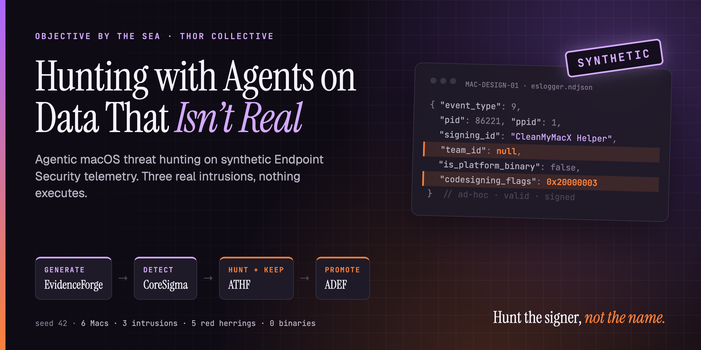

# Hunting with Agents on Data That Isn't Real



**Agentic macOS threat hunting on synthetic ESF telemetry** · Objective by the Sea

Sydney Marrone ([@letswastetime](https://x.com/letswastetime)) and Lauren Proehl ([@triw0lf](https://x.com/triw0lf)) · [THOR Collective](https://github.com/THORCollective)

Real macOS malware is dangerous to teach with and a pain to reproduce. This repo holds
everything from the talk: one fully synthetic, inert dataset that reproduces three real
macOS intrusions (AMOS/Atomic Stealer, DPRK BeaverTail and CloudMensis-style persistence),
the Sigma rules that detect them, and the ATHF hunt files an agent wrote while hunting it.

Nothing in this repo executes. Every malicious event is a labeled, inert record.

## Watch the demo

[▶ Recorded demo (5 min, MP4)](demo/obts-agentic-hunt-demo.mp4):
generate the dataset, hunt it on the Splunk stage dashboard, then let the agent hunt it on its own.
The agent segment is an unedited run (19 Nov 2026) played at 3× speed, scored against `GROUND_TRUTH.md` at the end.
It's a separate run from the rehearsal hunt in `hunts/`, with the same verdicts.

## The tools

| Layer | Tool | |
|---|---|---|
| Generate | [EvidenceForge](https://github.com/THORCollective/EvidenceForge) (THOR Collective fork) | Deterministic synthetic ESF (`eslogger` NDJSON) and Zeek telemetry |
| Detect | [macOS CoreSigma](https://github.com/Nebulock-Inc/macos-coresigma) | Sigma rules → ECS queries for ESF via the `ecs_macos_esf` pipeline |
| Hunt + remember | [ATHF](https://github.com/Nebulock-Inc/agentic-threat-hunting-framework) | The LOCK loop: Learn, Observe, Check, Keep |
| Promote | [ADEF](https://github.com/Nebulock-Inc/agentic-detection-engineering-framework) | From validated hunt to production detection |

## What's here

| Path | Contents |
|---|---|
| `scenario/` | The EvidenceForge scenario: six Macs, three intrusions, red herrings, plus a Splunk hunt kit |
| `rules/coresigma/` | CoreSigma rules used in the demo |
| `hunts/` | The ATHF hunt file the agent wrote, plus its queries |
| `slides/` | The deck as a self-contained HTML slideshow (download, open in a browser, arrow keys) |
| `demo/` | The recorded demo (MP4) |
| `assets/` | README banner |

## Rerun the hunt

```bash
# 1. Generate the dataset (deterministic: same scenario + seed + version = same data)
git clone -b v2.2.0 https://github.com/THORCollective/EvidenceForge
cd EvidenceForge && uv sync
uv run eforge generate ../scenario/scenario.yaml -o ./output --seed 42

# 2. Check your work against the answer key
cat ./output/GROUND_TRUTH.md

# 3. Convert the rules
pip install sigma-cli pysigma-backend-elasticsearch
sigma convert -t lucene -p ecs_macos_esf ../rules/coresigma/

# 4. Hunt with memory (the [splunk] extra adds `athf splunk search`)
pip install "agentic-threat-hunting-framework[splunk]"
athf init
```

See `scenario/README.md` for the environment and the three storylines, and `scenario/splunk/README.md`
to load the data into a local Splunk with the 18 hunt searches and the stage dashboard used in the demo.

## License

MIT. See [LICENSE](LICENSE).
